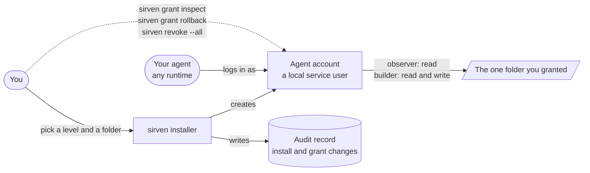

<p align="center">
  
</p>

# sirven

**Secure access levels for your personal agent.** Give your agent its own account on your machine, pick how much it can touch, see every grant, and take it all back with one command. No hosted middleman: the agent runs as a local user you own.



## What you get

| | |
|---|---|
| **Its own account** | The agent works as a dedicated local user. Your personal credentials are never copied across. |
| **Three access levels** | `observer` reads the folder you grant, `builder` reads and writes it, `operator` is `builder` today, with owner-listed service restarts and log reads designed. None of them ever gets root or `sudo`. |
| **Nothing granted by default** | A folder is granted only when you name it. System folders, your whole home folder, and credential folders such as `.ssh` are refused. |
| **A way back** | `sirven grant inspect` shows what is in force. `sirven grant rollback` reverses the last change. `sudo /usr/local/sbin/sirven revoke --all` cuts the agent off now and keeps the records. every root command after the first install goes through that launcher, which runs the root-owned copy, never a folder the agent may have been granted. |
| **Plans before changes** | The installer prints its full plan first, and `--dry-run` changes nothing. |
| **Works with what you run** | Already have an agent? sirven adopts what it finds (Tailscale, bb, an earlier run) and does not replace it. |

## Quick start

```bash
git clone https://github.com/Joesirven/sirven.git
cd sirven
bash install.sh --dry-run        # read the plan first; this changes nothing
sudo bash install.sh             # answer two questions: level, folder
bash bin/sirven grant inspect    # see exactly what the agent can touch
```

Unpack the package where only you can write, and delete that folder after the install (or grant a path that does not hold it): as root,
it is the only code that runs from a place the agent could reach. Install lays down the launcher `/usr/local/sbin/sirven` and a
root-owned kept copy in `/var/lib/sirven/package`; every root command after that goes through the launcher, for example
`sudo /usr/local/sbin/sirven revoke --all`.

The installer applies its plan to a real Linux machine when it is run as root (`sudo`). It prints the
plan first and then asks you to type `yes`; with `--yes` it asks nothing. On macOS it stops before
any change: use `--dry-run` to read the plan, or `--prefix` for a fake root. `sudo bash uninstall.sh`
removes what the install created. With the npm package (`npm install -g @joesirven/sirven`),
`sirven` is on your path directly.

Full walkthrough: [docs/WALKTHROUGH.md](docs/WALKTHROUGH.md).

## What it does not do yet

Stated plainly so you can trust the rest. Applying the plan to a macOS machine is not verified yet, so there the installer stops before any change: use `--dry-run`, or `--prefix` to apply into a fake root. The kill switch (`revoke --all`) applies on Linux as root and is plan output on macOS; there, `uninstall.sh` (behind the same switch) is the way to undo an install. The audit log covers the install and every grant change. Per-session and per-command logging goes through a forced-command wrapper that is designed and not built yet. Kernel-level auditing is designed and not built. The `operator` level's service restarts and log reads are designed and not built.

## Read more

- [docs/WALKTHROUGH.md](docs/WALKTHROUGH.md): install in three steps
- [docs/BOOTSTRAP.md](docs/BOOTSTRAP.md): the one-line installer, its pinned release, and the copy kept after install
- [docs/PERMISSIONS.md](docs/PERMISSIONS.md): the access levels and what each one allows
- [docs/phone-interface.md](docs/phone-interface.md): let your agent drive your own plugged-in
  iPhone, opt in per session, every action logged in plain words
- [docs/COMPONENTS.md](docs/COMPONENTS.md): optional components, added with `sirven add`, such as
  `sirven add crm` for Twenty, a self-hosted customer relationship manager. sirven never needs one
- [docs/peer-routing.md](docs/peer-routing.md): how attestation, site review, the policy engine,
  and the sharing ledger connect, and what still stands before peer routing ships

## Keep my Mac awake for my agent

Your personal agent often works while you are away from the keyboard. If the Mac goes to sleep
halfway through, the work stops. `sirven awake` keeps the Mac awake while your agent has work in
flight, and only then. Inspired by Sleepless by itskoosh.

What it does, and what it never does:

- It holds a macOS power assertion (the supported IOKit interface for "do not idle-sleep right
  now") while at least one agent task is in flight, and releases it the moment the last one ends.
  The display can still sleep; the Mac stays awake.
- Every assertion names its work. `pmset -g assertions` lists it as "sirven keep-awake: your agent
  has work in flight", and its details name each task and its reason. sirven never holds an
  assertion without work to point to.
- Work is tied to the agent process doing it. If that process exits or crashes, the hold ends
  by itself. Every task also has a lease (12 hours unless the agent renews it).
- You are in charge. `sirven awake off` turns it off; `sirven awake release` lets the Mac sleep
  right now without stopping the work.
- Lid-closed operation is a separate setting, off until you turn it on.

### Commands

```
sirven awake begin TASK --reason TEXT --owner PROCESS   the agent starts work (holds the Mac awake)
sirven awake end TASK                    the work is done (the hold ends when no work remains)
sirven awake run --reason TEXT -- COMMAND   hold for exactly as long as one command runs
sirven awake status [--json]             what is holding the Mac awake, since when, and why
sirven awake release                     release the hold now; the work keeps running
sirven awake on | off                    the keep-awake switch (on by default)
sirven awake lid on | off                stay awake with the lid closed too (off by default)
sirven awake about                       what this is, and the credit
```

`sirven awake status` reads like this:

```
keep-awake: on
lid-closed: off
holding: yes, since 2026-10-11 17:10:42 (4 minutes), by process 67801, sirven-keep-awake hold
system confirms: process 67801 holds PreventUserIdleSystemSleep named "sirven keep-awake: your agent has work in flight"
work in flight (1):
  inbox-summary  since 2026-10-11 17:10:42  owner process 66861  holding
    summarize the inbox
release now: sirven awake release
```

The "system confirms" line is read from macOS itself, not from sirven's own records.

Build it once with `make keep-awake` (it needs the Swift toolchain from Xcode or the command line
tools). Details for developers, including the JSON the menu bar app reads, are in
[macos/keep-awake/README.md](macos/keep-awake/README.md).

### Lid-closed operation, and the one approval it needs

A power assertion keeps a Mac awake with the lid open. With the lid closed, macOS sleeps anyway,
and keeping it awake then means changing a system setting that only an administrator can change.
sirven does that through a small privileged helper, and only for this.

How the helper gets installed, step by step:

1. Nothing happens at install time or the first time sirven runs. Most people never need the
   helper, and they never see a prompt.
2. The first time you turn lid-closed operation on (`sirven awake lid on`, or the switch in the
   sirven menu), sirven asks macOS to register its helper through the Service Management
   framework (`SMAppService`). sirven never asks for your password.
3. macOS takes it from there with its own approval. It shows a notice that sirven added a
   background item, and sirven opens System Settings at General, Login Items and Extensions, where
   you switch sirven on. macOS asks for your fingerprint or your password there, in its own
   prompt. sirven never sees either.
4. That is the one approval. The signed helper stays installed, and sirven never asks for it
   again. You can switch it off in the same System Settings pane at any time, and lid-closed
   operation then stops working until you allow it again. Not yet verified: whether macOS asks
   again after a signed update of the sirven app. That gets checked once the app is signed.

What the helper does while it is allowed:

- It turns the system's sleep-disabled setting on only while sirven is holding the Mac awake for
  agent work and you have lid-closed operation on. When the work queue drains, it turns the
  setting back off.
- If sirven crashes or quits, the connection to the helper drops, and the helper turns the
  setting back off by itself. If the Mac loses power mid-hold, the helper turns it off at its next
  start.
- It only ever turns off a setting it turned on itself: if you already had the setting on, it
  leaves it alone. It accepts connections only from the signed sirven app.

Two honest notes. The setting the helper uses (`pmset disablesleep`) is the only way macOS offers
to keep a Mac awake with the lid closed and no external display, and Apple's `pmset` manual page
does not document it. A closed laptop in a bag can get warm, which is why lid-closed operation is
off by default and only active while there is work to point to.

### Credit for keep-awake

Inspired by Sleepless by itskoosh. sirven's keep-awake is its own implementation. No live
repository for Sleepless could be confirmed, so none is linked.

## Credits

- The iPhone integration follows the approach of
  [iPhone-use](https://github.com/zhongerxin/iPhone-use) by ZHONG XIN (MIT license): an agent
  drives a real iPhone over USB through WebDriverAgent. sirven's integration layer is its own
  code.
- [WebDriverAgent](https://github.com/appium/WebDriverAgent) is from the Appium project, under
  the BSD license (Berkeley Software Distribution). You fetch and sign it yourself at setup;
  sirven does not bundle it.
