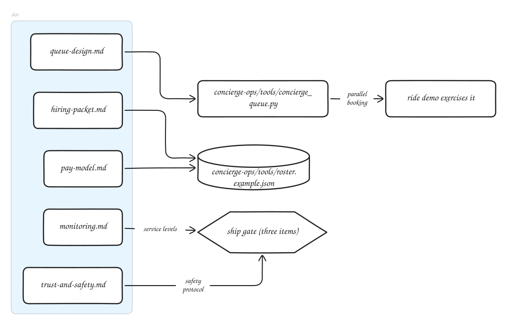
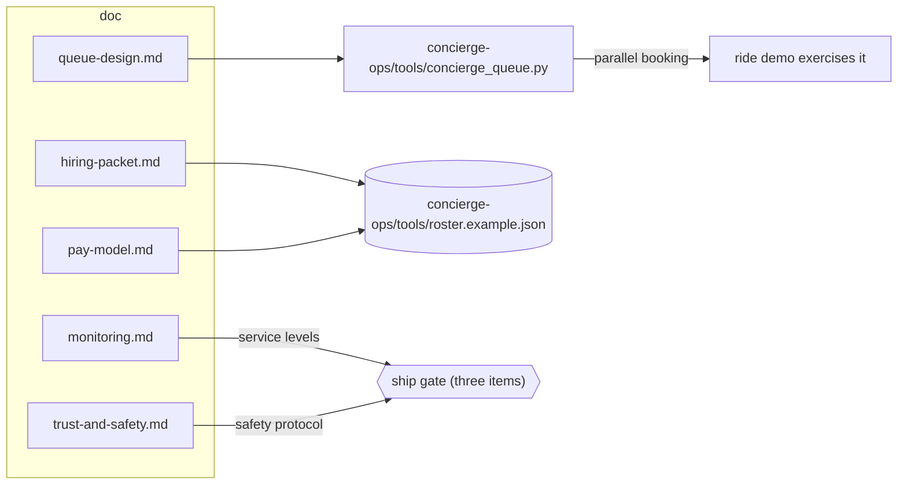

# Human-concierge operations, San Francisco

<!-- architecture:begin concierge-ops -->

## Architecture: concierge-ops

concierge-ops/ is operations documentation plus one queue tool. The ride demo is the only runnable code that exercises the pattern today. Three gate items hold shipping.

Diagram source, generated from `docs/architecture/graph.mjs`:

<!-- architecture:end concierge-ops -->

Operations for the human-concierge layer: the people who book rides a personal agent cannot
book on its own, Waymo first. San Francisco only (Jose's decision of October 11, 2026). Jose
does all hiring; this folder is the preparation. Nothing here has been posted, sent, or
signed up for.

Positioning (Jose's decision): the concierge layer is a back-end detail, not a led-with
feature. It is disclosed plainly wherever it operates and never used as a headline.

## Ship gate

> "Do not ship the human-concierge tier until the service-level targets, the concierge trust
> and safety protocol, and the user-facing disclosure of concierge involvement are all in place."

| Gate item | Where | State |
| --- | --- | --- |
| Service-level targets | [queue-design.md](queue-design.md), [monitoring.md](monitoring.md) | Defined, measured, alerted, and reported in the prototype; production timers not built |
| Trust and safety protocol | [trust-and-safety.md](trust-and-safety.md) | Drafted, awaiting Jose's review |
| User-facing disclosure | Owned by the user interface and agent documentation work | Not this folder; required contents listed in the protocol, section 2 |

The gate is not met until Jose approves the protocol, the open decisions below are settled,
and the disclosure exists.

## Decisions for Jose

1. **Waymo's rules, read first.** Whether Waymo's current rider terms let an account holder
   book for someone else who rides alone, and how that rider boards. Everything else depends
   on the answer. Hiring packet, section 6.
2. **What happens when a service objects:** sirven pauses that service, tells users why, and
   argues in the open. Publish this commitment as written? Protocol, section 1.
3. **Service accounts:** a sirven business account if one exists; else sirven-controlled
   accounts in each concierge's real name (recommended); or concierges' personal accounts
   (not recommended). Hiring packet, section 6.
4. **Pay model:** hourly at $28, hybrid at $20 an hour plus $4 a booking (recommended), or per
   ride only (cannot meet the targets). Pay model, section 3.
5. **Worker classification:** part-time employees through a payroll provider (recommended),
   confirmed with an employment lawyer. Pay model, sections 2 and 4.
6. **Coverage window:** narrow, 43 hours a week (recommended for the first month), or wide, 105
   hours. Hiring packet, section 5.
7. **Second line during launch:** Jose himself, or a paid backup shift. Hiring packet, section 5.
8. **Background checks:** whether to run them (only after a conditional offer). Hiring packet,
   section 4.
9. **Target definitions:** quote clock from submit, booking clock from the user's acceptance.
   Queue design, section 1.
10. **Consent shape:** a standing, revocable consent plus a per-ride notice, or a question on
    every ride; depends on decision 13. Queue design, section 6.
11. **Trip detail retention:** none beyond the open request (recommended), or a short window
    for disputes. Protocol, section 4.
12. **Role description and scenario questions:** approve or edit before any use. Hiring packet,
    sections 1 and 2.
13. **Who quotes:** software quotes and a person only confirms the booking (the connector
    contract thread's shape; recommended, since the concierge then sees only trips the user
    chose), or a person quotes every request. Queue design, section 5.
14. **Disclosure sentence:** approve or edit the draft the connector contract shows on every
    concierge-served option. Protocol, section 2.

## Contents

- [hiring-packet.md](hiring-packet.md): role description, screening criteria, paid work sample,
  onboarding checklist, coverage proposal, account-provisioning runbook.
- [queue-design.md](queue-design.md): targets, request flow, the prototype, the production
  tooling proposal, dependencies on other threads.
- [monitoring.md](monitoring.md): per-request timings, alerts, weekly summary.
- [pay-model.md](pay-model.md): hourly, hybrid, and per-ride options with low-volume costs.
- [trust-and-safety.md](trust-and-safety.md): the justice framing, consent and disclosure, what
  a concierge may see and must never do, data rules, escalation, offboarding.
- [tools/concierge_queue.py](tools/concierge_queue.py): the queue and service-level prototype;
  tests in `tests/unit/test_concierge_queue.sh` (`bash tests/run.sh concierge`).

This folder is operations material, not part of the installed package; it is not listed in
`package.json`.
