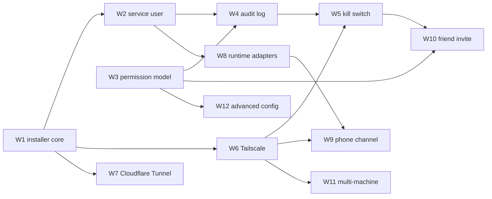

# Scope

Status: draft for Jose's review, 2026-10-09. Working name **Sirven**, subtitle "secure agent access".
The name lives only in `project.json`; this document says "Sirven" or "the package".

Updated 2026-10-15: the repository name, the Tailscale row (W6), the `--with-bb` row (W9), and the demo outline row (W13) now match the repository (see docs/status/2026-10-15-docs-claims.md). The other status cells are as written on 2026-10-09.

## Name

- **Sirven is a working name.** Known public-name collisions: sirven.com (an image content delivery
  network) and getsirven.com. Revisit the name before any public launch.
- Positioning: "the shadcn of agent access": install it, own it, no hosted middleman.
- The GitHub repository is `Joesirven/sirven`, and `repository` in `project.json` says so. It was
  `Joesirven/secure-agent-access` when this draft was written on 2026-10-09.

## What it is

An open-source onboarding package that lets an owner point their agent runtime (Claude Code,
Codex, or Pi) at a macOS or Linux machine and get secure agent access in one sitting. The owner
texts their agent from a phone, the agent starts work on the owner's machine, and that access is
scoped, revocable, and (install and grant changes only, for now) logged. "The shadcn of agent access": you copy in a small, readable set of
scripts and data files that you own and can change. It is not a hosted service.

The defaults are the product. A fresh install is conservative: a dedicated service user with no
administrator rights, access granted per path, install and grant changes written to an audit log (session and
command logging is planned, not built yet), and one command that revokes everything.

## Hard constraints

1. **No one-time codes by email, anywhere.** Not for bootstrap, not for invites, not for recovery.
2. **Interactive once, then keys only.** The owner approves a machine once in a browser (Tailscale
   login or Cloudflare dashboard). After that, every connection uses keys: Tailscale auth keys, a
   Cloudflare Access service token, and SSH keys. No passwords are stored or typed by agents.
3. **Nothing widens itself.** A grant never grants more grants. The agent's service user cannot
   edit its own policy, its own audit log, or the kill switch.
4. **Dry run first.** Every mutating command prints its full plan with `--dry-run` and applies the
   identical plan without it.
5. **Owner-only actions stay owner-only.** No level, including the highest, gets root or `sudo`,
   restarts system services the owner did not list, or touches the machine's own tunnel, SSH
   server, or account configuration.
6. **Nothing public** until Jose reviews: no public repository, package registry, or posts.

## Terms

| Term | Meaning |
|---|---|
| Owner | The person whose machine it is. Runs the installer, holds the kill switch. |
| Agent runtime | The coding agent program: Claude Code, Codex, or Pi. |
| Transport | How a remote client reaches the machine: Tailscale (first) or Cloudflare Tunnel (second). |
| Service user | The operating system account the agent runs as, named `agent` by default. Not an administrator. |
| Level | A preset bundle of permissions: `observer`, `builder`, `operator`. Defined in `docs/PERMISSIONS.md`. |
| Grant | A level applied to specific paths for a specific principal (the owner's agent or a friend's), with an optional expiry. |
| Invite | A grant to a friend's agent, bound to that agent's public key. |
| Audit log | Append-only record of install and grant changes. Session and command logging is planned, not built yet. |
| Kill switch | One command that revokes every key, ends every session, and locks the service user. |
| Access control list | Per-file permission entries (`setfacl` on Linux, `chmod +a` on macOS) used to grant one path without opening the whole home directory. |

## Workstreams

Each workstream lists what it delivers, what it needs first, and its honest state tonight.

| # | Workstream | Delivers | Depends on | Tonight |
|---|---|---|---|---|
| W1 | Installer core | `install.sh`: operating system detection, preflight checks, at most two setup questions with visible defaults (`--yes` and `SIRVEN_*` for no questions), a plan-then-apply engine, `--dry-run`, idempotent re-runs, `--prefix` for a fake root | none | **Build** |
| W2 | Service user | Create or reuse `agent` (Linux `useradd`, macOS `sysadminctl`/`dscl`), no administrator group, locked password, SSH key only | W1 | **Build**, verified by dry run and fake-root tests; real creation on Linux as root (verified in the harness container); macOS real creation is built but switched off by default |
| W3 | Permission model | Levels as data (`levels/*.json` or similar), grant schema, a compiler from grants to access control list commands | none | **Design doc plus reference data and compiler** |
| W4 | Audit log | Log format (JSON lines), location owned by the owner, append-only from the agent's point of view, session start and end, every command via a forced-command wrapper | W2, W3 | **Format designed and written for install and grant changes; the wrapper is designed, not built** |
| W5 | Kill switch | `revoke --all`: remove authorized keys, end sessions, lock the user, remove tunnel access, write a final audit entry | W2, W4, W6 | **Built on Linux** (applies in a container and on a real machine as root, verified by the harness in a container); plan output on macOS |
| W6 | Transport: Tailscale | Install check, `tailscale up` with an auth key after one interactive login, tagged device, a policy snippet that lets only the owner's devices reach the agent port | W1 | **Built for Linux containers**: the plan, the join as `tag:agent`, and the logout on revoke and uninstall (see the alpha cut table). Never run against a real tailnet in tests; the live join needs a test key and has not run yet |
| W7 | Transport: Cloudflare Tunnel | `cloudflared` tunnel plus Cloudflare Access service token in front of SSH | W1 | **Built on Linux** (apply and teardown verified in the harness container against a stand-in for the Cloudflare API; the run against a real account needs a test token); Cloudflare Access stays an owner step; plan output on macOS |
| W8 | Runtime adapters | Per-runtime setup for the service user: Claude Code, Codex, Pi. Config written into the service user's home, never the owner's | W2 | **Claude Code first**; Codex and Pi stubbed with clear "not yet" errors |
| W9 | Phone-to-agent channel | How the owner's text reaches the runtime on the machine | W6 or W7, W8 | **Not built by the package.** Alpha relies on an existing remote client (bb or the runtime's own remote mode) over the transport. Optional `--with-bb` adds a bb note to the plan only; orca to be specified by Jose |
| W10 | Friend invite | `invite --level observer --path ~/code/app --key <their public key> --expires 7d`, plus `revoke <invite>` | W3, W4, W5 | **Designed** in `docs/PERMISSIONS.md` |
| W11 | Multi-machine | An inventory file listing machines; the same grants applied to each over SSH from the owner's laptop; per-machine state and drift report | W1 to W6 stable | **Designed only** |
| W12 | Advanced config | One config file (its name derived from `project.json`) for custom levels, extra paths, log retention, transport options | W3 | **Schema sketched**, not built |
| W13 | Docs, demo, video | README with diagram, a demo outline (`docs/DEMO.md`, not written yet), 15-second explainer | none | **Build** |
| W14 | Test harness | Fake-root unit tests (any machine), dry-run golden files, Linux container tests for real user and access control list creation, macOS testing plan | W1 | **Unit and dry-run tests tonight**; container tests if a container is available on the MacBook |

## Dependency order

The critical path to the promise in the video ("text your agent, it builds on your machine,
safely") is W1 → W2 → W3 → W4 → W6 → W8 → W9. Everything else makes it safer or broader.

## Sequencing

| Stage | Contents | Exit test |
|---|---|---|
| **Alpha (tonight)** | Repository scaffold; `docs/PERMISSIONS.md` with levels as data; `install.sh` with dry run, fake root, service-user and access-control-list plans, Tailscale path, Cloudflare path documented; README with diagram; `docs/DEMO.md`; explainer video | Tests pass on the MacBook; `install.sh --dry-run` prints a complete plan on macOS and Linux; nothing applied to a real machine |
| Alpha + 1 | Apply mode verified in a Linux container (real user, real access control lists); audit wrapper; kill switch apply; Claude Code adapter end to end over Tailscale on a spare machine or virtual machine | A recorded demo following `docs/DEMO.md` on a throwaway machine |
| Beta | Friend invite and revoke; Codex and Pi adapters; macOS apply mode verified in a virtual machine; Cloudflare Tunnel apply mode | Invite, use, and revoke round trip, with audit entries for each step |
| Full scope | Multi-machine inventory; advanced config; drift report; uninstall | Two machines onboarded from one config, then fully revoked |

## Alpha cut: built tonight versus designed

| Capability | Built tonight | Designed, not built | Not started |
|---|---|---|---|
| Install plan, dry run, idempotency | ✓ | | |
| Service user creation (plan; applies on Linux as root; macOS apply is switched off by default) | ✓ | | |
| Levels as data and grant-to-access-control-list compiler | ✓ | | |
| Per-path access control lists on macOS | plan output | apply verification needs a macOS virtual machine | |
| Audit log format | ✓ (spec) | capture wrapper | kernel-level audit (Linux `auditd`, macOS endpoint security) |
| Kill switch | apply on Linux as root (verified in the harness container); plan output on macOS | apply on macOS | |
| Tailscale transport | apply and teardown in a Linux container (join as `tag:agent`, logout on revoke and uninstall; live against a test tailnet needs a test key) | apply on a real machine and a real tailnet | |
| Cloudflare Tunnel transport | apply and teardown in a Linux container (tunnel, alias record and service made, recorded and taken away by revoke and uninstall; live against a test account needs a test token) | apply on a real machine and a real account; Cloudflare Access made by the installer | |
| Claude Code adapter | plan | apply | |
| Codex, Pi adapters | | ✓ | |
| Friend invite and revoke | | ✓ | |
| Multi-machine | | ✓ | |
| Advanced config | | schema sketch | |
| Phone-to-agent channel | | relies on bb or the runtime's remote mode | own channel |
| `--with-bb` flag | plan | | orca install (needs Jose's spec) |

## Risks

1. **Audit capture is weaker than it sounds.** A forced-command wrapper logs what enters through
   SSH, but a process the agent starts can do things the wrapper never sees. Honest framing once
   the wrapper is built: "every session and command you send is logged", not "every system call". Kernel-level
   audit is designed, not built.
2. **macOS access control lists and privacy controls.** macOS protects some folders (Desktop,
   Documents, Downloads) behind privacy prompts that a service user cannot answer. Alpha defaults
   to paths outside those folders and documents the limitation.
3. **Account creation needs administrator rights once.** The installer must run with `sudo` for
   user creation. That is the single interactive privileged step; the plan is printed first.
4. **Tailscale and Cloudflare change their command-line tools.** Pin minimum versions in
   preflight and fail loudly.
5. **Runtime credentials.** Each runtime needs its own login for the service user. That is an
   interactive step per runtime, and the installer must never copy the owner's credentials across.
6. **Friend invite is the riskiest feature.** A friend's agent on your machine is a remote
   stranger with a shell. It ships last, read-only by default, with mandatory expiry.
7. **Testing reach.** Tonight's tests prove plans, not effects. Real user and access control list
   creation is verified on Linux in the harness container; it is unverified on a real Linux machine outside it, and on macOS until a run on a real Mac (virtual machine or the owner's check) exists.
8. **Load on the server.** All builds and tests run on the MacBook; the server only
   coordinates.

## Open questions for Jose

1. What is "orca" in the `--with-bb`/orca install flag, and where does its installer live?
2. Should the default service user name be `agent`, or derived from the project name?
3. Is "relies on bb or the runtime's remote mode" acceptable for the phone channel in alpha, or is
   a built-in channel required before anything is shown?
4. License: `project.json` says MIT. Confirm.
