# Architecture diagrams

<!-- architecture:begin system-overview -->

## Architecture: System overview

The runtime seam asks the policy engine, which reads the compiled levels and writes to audit.

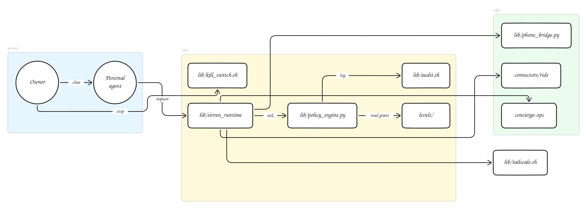

Diagram source, generated from `docs/architecture/graph.mjs`:

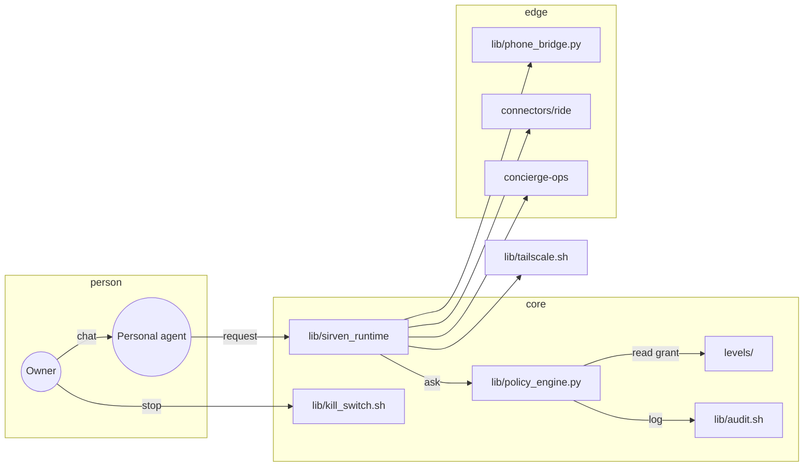

<!-- architecture:end system-overview -->

Every diagram in sirven comes from one source: `docs/architecture/graph.mjs`. The build in
`docs/architecture/build.mjs` emits Mermaid source under `diagrams/`, renders a hand-drawn vector
image under `rendered/` with the `pretty-mermaid` package, and verifies that every README fence
still matches the source. If a fence drifts, the build fails.

The Remotion architecture video in `video/src/architecture/` reads the same graph module and lays
each diagram out on the same column grid. There is one formatting language across the written
docs and the video.

- Package used to render: `pretty-mermaid@0.1.0` by `kamranahmedse`, pinned in `video/package.json`.
  Why this one, not plain Mermaid styling: the maintainer chose the package. It is a renderer for Mermaid
  source that writes vector images with a hand-drawn stroke (through `roughjs`) and the Balsamiq
  Sans Neue face, and it reads the same `flowchart` and `sequenceDiagram` dialects, so one source
  of truth stays one source of truth. The committed vector images show that style on viewers that
  do not render Mermaid themselves; the fence stays in every README, as the project requires.

## Build

```
npm --prefix video install
node docs/architecture/build.mjs           # write, render, and verify
node docs/architecture/build.mjs --check   # verify only, no writes
```

The check also compares each `diagrams/*.mmd` source and `rendered/*.svg` image with a fresh build
of `graph.mjs`, so a stale image fails the check too. Both need pretty-mermaid. After changing
`graph.mjs`, run `node docs/architecture/insert.mjs` for the README fences, then
`node docs/architecture/build.mjs` (without `--check`) to regenerate the sources and images, and
commit them together.

## Topics not covered by a README

These four topics do not have a README of their own; the diagram source and rendered vector
image live here. The fenced Mermaid source is the authority. For written detail, follow the file
names on the nodes.

<!-- architecture:begin access-levels -->

## Architecture: Access levels, grant audit, and rollback

The three level files under levels/ compile into grants; every apply writes to the audit log; `sirven grant rollback` reverses one change by reading that log; the kill switch removes every entry.

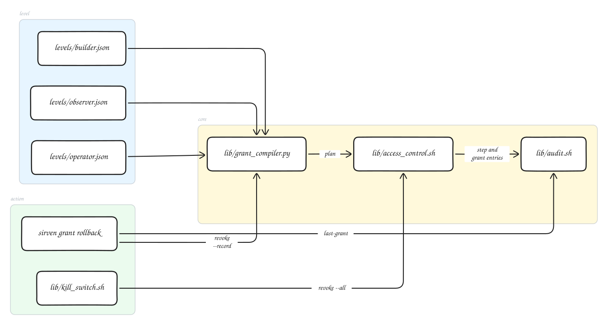

Diagram source, generated from `docs/architecture/graph.mjs`:

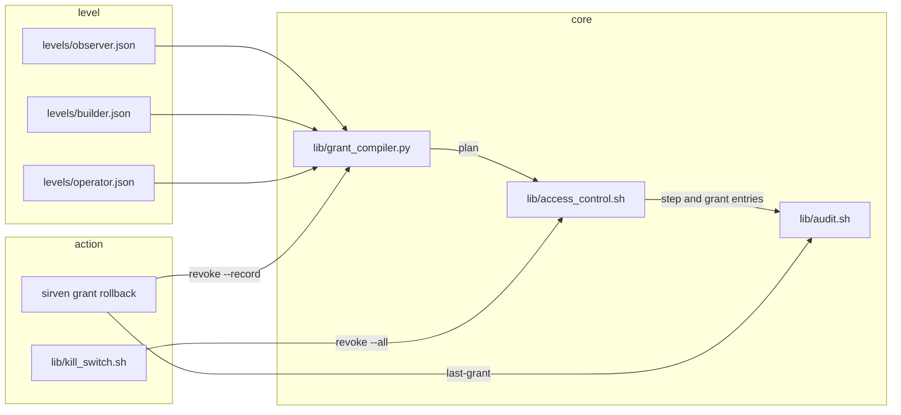

<!-- architecture:end access-levels -->

<!-- architecture:begin installer -->

## Architecture: Plan-first installer

install.sh runs preflight and questions, writes a plan, and only then adopts, lays out, and installs components.

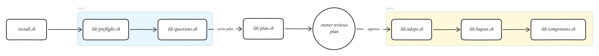

Diagram source, generated from `docs/architecture/graph.mjs`:

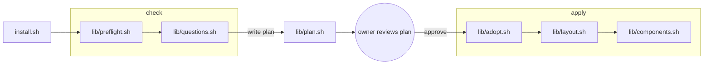

<!-- architecture:end installer -->

<!-- architecture:begin runtime-seam -->

## Architecture: Runtime seam and policy decisions

Every fetch crosses one seam. The policy engine reads the compiled grants and writes a decision to the log.

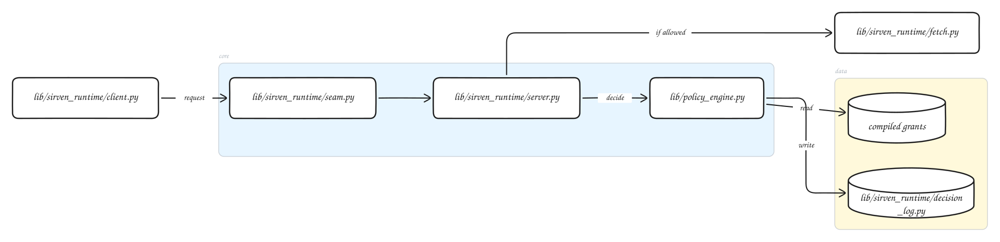

Diagram source, generated from `docs/architecture/graph.mjs`:

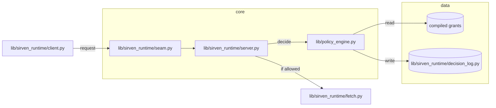

<!-- architecture:end runtime-seam -->

<!-- architecture:begin phone-bridge -->

## Architecture: iPhone bridge and consent gates

The owner opts in per session (`sirven phone allow`), the bridge speaks only to a plugged-in phone through WebDriverAgent, every money-bearing tap waits on a hold token, and every event lands in actions.jsonl as plain words. The bridge never touches the phone's own Face ID or Apple Pay prompts.

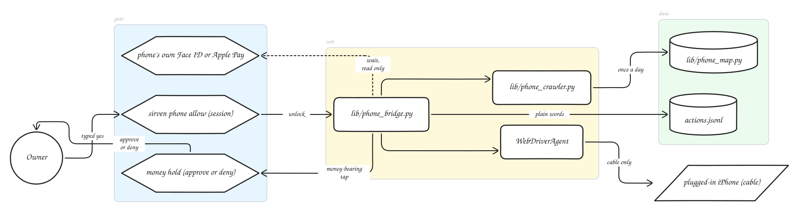

Diagram source, generated from `docs/architecture/graph.mjs`:

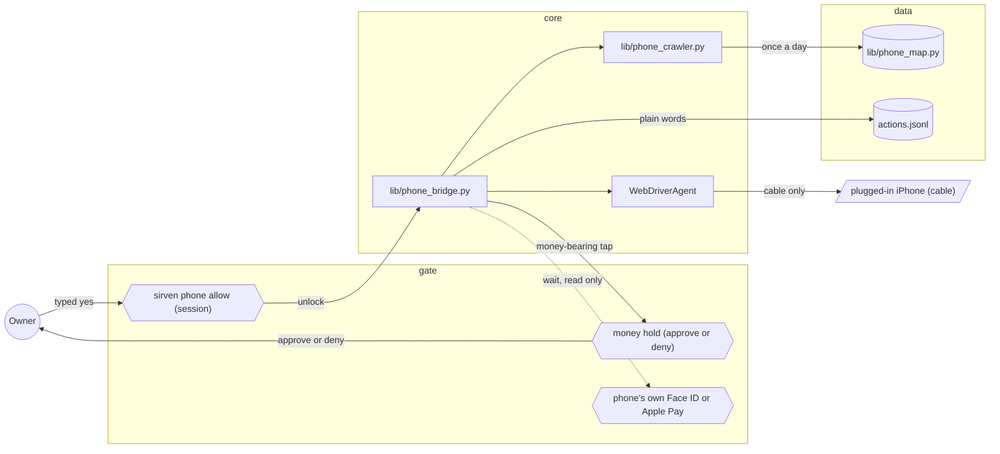

<!-- architecture:end phone-bridge -->

<!-- architecture:begin peer-routing -->

## Architecture: Peer routing: policy, attestation, and carrier transport built, ship gate closed

Policy, attestation, the site review workflow, and the carrier transport are built and tested on loopback. Still open: the user-side wiring in lib/sirven_runtime/seam.py, authentication between two machines, and the ship gate, which stays closed.

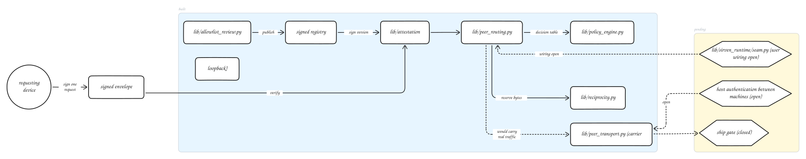

Diagram source, generated from `docs/architecture/graph.mjs`:

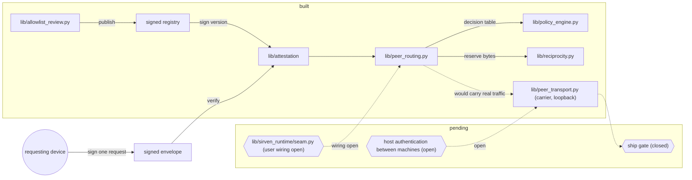

<!-- architecture:end peer-routing -->

## Ship gate

The peer routing diagram shows what is built and what is not. Jose's own words, carried verbatim
from `docs/peer-routing.md`:

> Do not ship any peer routing of authenticated traffic until the attestation layer and the
> site-allowlist review workflow are both working end to end.

Policy, attestation, the site review workflow, and the carrier transport (`lib/peer_transport.py`)
are built and tested on loopback. Still open: the user-side wiring in `lib/sirven_runtime/seam.py`,
authentication between two machines, and the ship gate. So this diagram marks the real-traffic edge
dashed and the gate node closed. This document never claims peer routing works.
